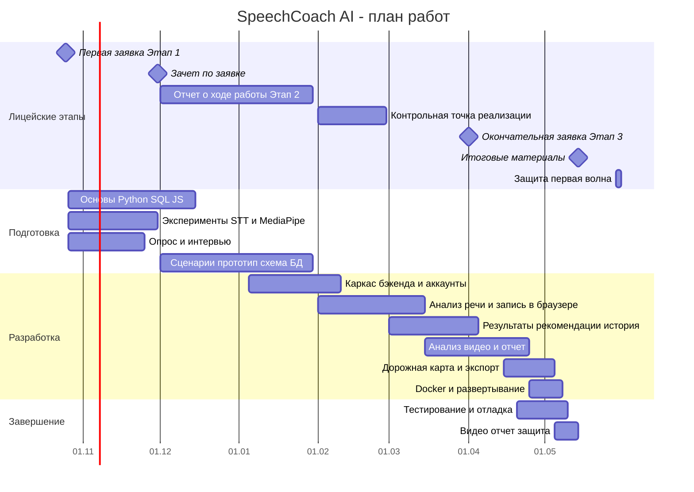

# Лев Стояльцев — «SpeechCoach AI — ассистент анализа и развития навыков выступления»

### Группа: 10 - И - 3
### Электронная почта: levstoyaltsev@gmail.com
### Tg: lewqh

**[ НАЗВАНИЕ ПРОЕКТА ]**

«SpeechCoach AI — ассистент анализа и развития навыков выступления»

**[ ПРОБЛЕМНОЕ ПОЛЕ ]**

Публичные выступления — защита проектов и ИВР, презентации, собеседования — регулярная часть учебной и профессиональной жизни школьников и студентов. В подготовке участвуют выступающий и эксперт (учитель, научный руководитель, наставник), который оценивает подачу материала и даёт обратную связь.

Выступающий сталкивается со следующими трудностями. Во-первых, обратная связь по подаче (темп речи, паузы, слова-паразиты, жесты, зрительный контакт) неполноценна: эксперт присутствует на ограниченном числе репетиций, а его комментарии носят качественный характер и не содержат измеримых показателей, по которым можно проверить улучшение от репетиции к репетиции. Во-вторых, при самостоятельной репетиции выступающий не замечает значительную часть своих ошибок, поэтому его самооценка расходится с оценкой слушателей. В-третьих, занятия с коучем и платные курсы стоят от 40 000 за полный курс, а существующие приложения не превращают выявленную слабую сторону в конкретное упражнение, результат которого проверяется объективно.

Для обоснования проблемного поля будут проведены:
* количественный опрос: [?] вопросов, выборка — [?] респондентов (лицеисты и студенты, имеющие опыт защиты проектов), результаты: [?];
* качественные интервью: [?] вопросов, [?] респондентов из целевой аудитории и [?] экспертов (преподаватели, научные консультанты), результаты: [?].

**[ ЗАКАЗЧИК / ПОТЕНЦИАЛЬНАЯ АУДИТОРИЯ ]**

Заказчика у проекта нет, продукт ориентирован на целевую аудиторию:

* **Лицеисты 10–11 классов и студенты 1–2 курсов (15–19 лет)**, готовящиеся к защитам ИВР и учебных проектов. Выступают редко (несколько раз в год), волнение высокое, опыта самостоятельного анализа своих выступлений мало; пользуются преимущественно смартфоном и ноутбуком; для них важны бесплатность и русский язык анализа.
* **Студенты старших курсов бакалавриата и магистратуры (19–25 лет)**, готовящиеся к защитам курсовых и выпускных работ и к собеседованиям на стажировки. Выступают чаще, им нужны более точные метрики и история прогресса.
* **Молодые специалисты в клиентских и публичных ролях (22–30 лет)**: продажи, консалтинг, преподавание. Готовятся к презентациям и встречам в условиях нехватки времени, поэтому для них важен режим быстрого анализа.

Характеристики групп будут уточнены по результатам опроса: [?].

**[ АППАРАТНЫЕ / ПРОГРАММНЫЕ ТРЕБОВАНИЯ ]**

Продукт — веб-сервис, вычисления выполняются на сервере. Устройство пользователя должно обеспечивать запись звука и видео в браузере.

*Ноутбук / ПК:*
* процессор: 4 ядра, 2 ГГц и выше (уровень Intel Core i3 8-го поколения / AMD Ryzen 3 и выше, Apple M1 и выше);
* оперативная память: от 4 ГБ; свободное место на диске: 500 МБ для временных файлов (данные хранятся на сервере);
* видеокарта: встроенная, дискретная не требуется;
* ОС: Windows 10, macOS 12, Ubuntu 22.04 или новее;
* браузер: Google Chrome 110+, Mozilla Firefox 110+, Safari 16+, Яндекс Браузер 24+;
* веб-камера 720p (30 к/с) и микрофон; скорость соединения от 5 Мбит/с на отправку.

*Смартфон:* iOS 16+ (Safari 16+) или Android 10+ (Chrome 110+), от 3 ГБ ОЗУ, фронтальная камера 720p.

*Сервер (для тестирования и защиты):* [?]. Предположительно: 4 vCPU, 8 ГБ ОЗУ, 30 ГБ SSD, Ubuntu 22.04, дискретный GPU не требуется; конкретная площадка: [?].

*Стенд разработки:* MacBook Pro (Apple M4, 16 ГБ ОЗУ), смартфон Iqoo neo 10 CH для тестирования.

**[ ФУНКЦИОНАЛЬНЫЕ ТРЕБОВАНИЯ ]**

1. Работа с аккаунтом: регистрация, вход, восстановление и смена пароля, изменение параметров профиля, удаление аккаунта и записей.
2. Запись аудио выступления в браузере или загрузка аудиофайла (до 3 минут).
3. Анализ речи: темп (слов в минуту), паузы, слова-заполнители с привязкой ко времени записи.
4. Просмотр результатов анализа речи: графики метрик, расшифровка с подсветкой проблемных фрагментов.
5. Персональная рекомендация упражнения на основе слабейших метрик пользователя.
6. Запись видео выполнения упражнения в браузере или загрузка видеофайла (до 3 минут) с асинхронной обработкой и отображением статуса.
7. Анализ видео: аудиодорожка и невербальные метрики (прокси зрительного контакта, осанка, жестовая активность, стабильность головы).
8. Мультимодальный отчёт: речевые и невербальные метрики на одном экране с общей временной шкалой.
9. Дорожная карта: последовательность этапов, следующий этап открывается при достижении порогов по метрикам в нескольких последних попытках.
10. История выступлений и упражнений с графиками динамики метрик.
11. Экспорт отчёта по выступлению в PDF и истории метрик в CSV.
12. Режим «быстрый анализ перед встречей»: запись до 1 минуты и короткий чек-лист из 3–5 пунктов.

**[ ПОХОЖИЕ / АНАЛОГИЧНЫЕ ПРОДУКТЫ ]**

Анализ трёх программных продуктов, максимально приближенных к заданному функционалу, показал, что:

* **Orai** — не поддерживает анализ русской речи; платная подписка (стоимость: 963 рубля в месяц) ограничивает доступность для школьников и студентов; не проверяет выполнение упражнения по видео; следующий этап подготовки не зависит от измеримого улучшения.
* **Diktum** — не анализирует язык тела: жесты, осанку, зрительный контакт ; не проверяет выполнение упражнений по видео; основной функционал платный.
* **Yoodli** — ориентирован на английский язык; основной функционал платный (стоимость: 650 рублей в месяц) нет структурированной дорожной карты, в которой этап открывается по достижении порогов метрик; не рассчитан на академические выступления (защита проекта, ИВР).

**[ ИНСТРУМЕНТЫ РАЗРАБОТКИ, ИНФОРМАЦИЯ О БД ]**

* **Python 3.12 / FastAPI** — бэкенд и REST API. Python выбран из-за зрелой экосистемы для обработки речи и видео, FastAPI — из-за простоты и автоматической документации API.
* **HTML / CSS / JavaScript, Chart.js** — графический интерфейс; JavaScript необходим для записи звука и видео в браузере (MediaRecorder API), отказ от тяжёлого фреймворка снижает нагрузку на изучение.
* **PostgreSQL, SQLAlchemy, Alembic** — табличная БД: пользователи, записи, метрики, прогресс по дорожной карте; PostgreSQL выбрана как отраслевой стандарт с надёжными транзакциями.
* **faster-whisper или Vosk** — распознавание русской речи с временными метками (выбор по результатам эксперимента на собственных записях).
* **MediaPipe (Face Landmarker, Pose, Hands)** — невербальные метрики по видео; **FFmpeg** — извлечение аудио и кадров.
* **Docker, Git / GitHub, VS Code, pytest, Ruff (стиль PEP 8)** — контейнеризация, контроль версий, тесты, стиль кода.

**[ ЭТАПЫ РАЗРАБОТКИ ]**

Лицейские этапы: первая заявка (Этап 1, 25 октября 2026) → зачёт по заявке (до конца ноября) → пользовательские сценарии / отчёт о ходе работы (Этап 2, зачёт до 30 января 2027) → контрольная точка готовности к реализации (февраль) → окончательная заявка (Этап 3, 1 апреля 2027) → итоговые материалы (14 мая 2027) → защита первой волны (29–30 мая 2027). Показы кода №1 и №2: [?].

Собственные этапы:
* Изучение основ (Python, SQL, JavaScript), эксперименты с распознаванием речи и MediaPipe на собственных записях
* Опрос [и интервью] для обоснования проблемного поля
* Пользовательские сценарии, прототип интерфейса, схема БД
* Каркас бэкенда: аккаунты, БД, загрузка файлов
* Модуль анализа речи и интерфейс записи
* Результаты анализа, рекомендации упражнений, история
* Модуль анализа видео и мультимодальный отчёт
* Дорожная карта, экспорт PDF / CSV
* Контейнеризация и развёртывание
* Тестирование, валидация метрик, отладка
* Видео-демонстрация, отчёт, подготовка к защите

**[ ВОЗМОЖНЫЕ РИСКИ ]**

1. **Нехватка времени на изучение стека.** Я не работал с SQL, JavaScript, FastAPI, Docker, MediaPipe и MediaRecorder API; изучение каждой технологии займёт слишком много времени при загрузке на ИВР около 5 часов в неделю параллельно с учебной нагрузкой. Смягчение: сначала сквозной вертикальный срез (запись → анализ → результат), затем расширение; при отставании на контрольной точке в феврале — согласование продлённой траектории.
2. **Низкая точность определения слов-заполнителей в русской речи.** Модели распознавания (в частности, Whisper) склонны пропускать «э-э», «ну», «как бы» при расшифровке. Смягчение: до начала разработки измерить полноту и точность транскрибации на 5 собственных записях с ручной разметкой; запасной вариант — словарный поиск лексических заполнителей и акустическое выявление пауз.
3. **Недостаточная валидность невербальных метрик.** Зрительный контакт и осанка по обычной камере зависят от ракурса, освещения и расстояния. Смягчение: метрики названы прокси-показателями, в интерфейсе указаны требования к съёмке, проводится сверка с экспертной оценкой на 10 видео.
4. **Высокая вычислительная нагрузка при обработке видео.** Анализ 3-минутного видео может занимать больше времени, чем допустимо. Смягчение: ограничение длины видео, понижение частоты кадров до 15 к/с, асинхронная обработка; замер времени на целевом сервере.
5. **Приватность аудио- и видеоданных.** Записи содержат голос и лицо пользователя. Смягчение: явное согласие на обработку, удаление исходных файлов после извлечения метрик, хранение только агрегированных данных, функция удаления аккаунта.
6. **Сложности реализовать весь заявленный функционал к сроку.** Смягчение: сначала реализуются существенные требования (№3, №6–9), затем остальные; изменения вносятся только до окончательной заявки.